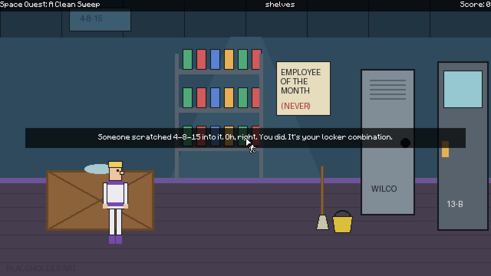

# Space Quest: A Clean Sweep

A free, non-commercial fan-made point-and-click adventure inspired by Sierra's Space Quest series.
Roger Wilco, janitor on the luxury starliner SCS Lavish Excess, has about an hour to stop
Dr. Purity Sterilis from flying the ship into the sun for "the ultimate deep clean."

Built with [Godot 4.7](https://godotengine.org/) and the
[Popochiu 2.2.1](https://github.com/carenalgas/popochiu) adventure framework, using its
Sierra-style action bar.

## Play it

1. Install Godot 4.7 (standard version, not .NET).
2. Open Godot, choose **Import**, and select this folder's `project.godot`.
3. Press **F5** (or the Play button).

**Controls (Sierra style):** move the mouse to the top of the screen to show the action bar.
Right-click cycles the cursor through Walk, Look, Interact and Talk. Left-click uses the current
action. Click anywhere to dismiss a text box.

## What's in this build

- **Supply Closet 13-B**, the first room, with placeholder art.
- The opening PA announcement from Dr. Sterilis.
- The locker puzzle (the combination is somewhere Roger looks every day), plus the mop, bucket
  and keycard.
- Look, Interact and Talk lines for everything in the room, and the first death scene
  (try napping on the crate twice).

## Project layout

| Path | What it holds |
| --- | --- |
| `game/rooms/` | One folder per room: scene, room script, props, hotspots, walkable areas |
| `game/characters/` | Roger and, later, everyone else |
| `game/inventory_items/` | Mop, bucket, keycard and future items |
| `game/gui/` | The Sierra action bar, copied from Popochiu's template so it can be restyled |
| `game/placeholders/` | Temporary art. Real art replaces these files at the same names and sizes |
| `tools/make_placeholders.py` | Redraws the placeholder art (`python3 tools/make_placeholders.py .`) |
| `tools/smoke_test.gd` | Plays the room's puzzle chain automatically to catch script errors |
| `addons/popochiu/` | Popochiu 2.2.1, unmodified |

Art direction: 640x360 pixel art, scaled up cleanly, with Roger in his classic white and purple
suit. The full design document lives in the project's Claude Docs.

## Legal

Space Quest is a trademark of Activision. This project is not affiliated with or endorsed by
Activision or Sierra. It contains no original Sierra art, music or code, and will always be free.
